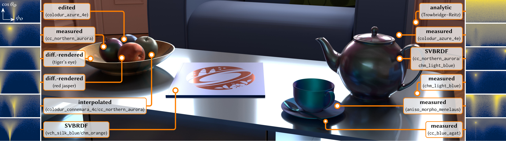

# Metalog Materials



This repository contains the implementation of our research paper [Metalog Materials](https://www.cg.tuwien.ac.at/MM) [Sakai\*, Hasbay\*, et al. 2026] (\* joint first authors).
It precomputes metalog-based BRDFs (e.g., measured materials from the [RGL database](https://rgl.epfl.ch/materials)) and renders them with [Mitsuba 3](https://www.mitsuba-renderer.org/), comparing the result against the reference material.
The diploma thesis [The Fellowship of Metalog BSDFs](https://doi.org/10.34726/hss.2026.134821) [Hasbay 2026] is a precursor of the paper and covers some aspects in greater detail.
BibTeX entries for both are in [CITATION.bib](CITATION.bib).

With the focus on research, this code is not intended for production. We appreciate your feedback, questions, and reports of any issues you encounter; feel free to [contact us](https://www.cg.tuwien.ac.at/staff/HiroyukiSakai)!

## Requirements

- An NVIDIA GPU with CUDA support. Fitting uses PyTorch (CUDA) and rendering uses the CUDA variants of Mitsuba 3.
- An NVIDIA driver supporting CUDA 12.6 (>= 560).
- Python 3.13 (see [Tested Environments](#tested-environments)) or Docker (see [Using Docker](#using-docker)).

## Installation

Clone the repository including its submodules:
```bash
git clone --recurse-submodules https://github.com/cg-tuwien/Metalog-Materials.git
cd Metalog-Materials
```

If you cloned without `--recurse-submodules`, fetch the submodules afterward:
```bash
git submodule update --init --recursive
```

Then set up the environment using one of the options below:
- [pip](#using-pip): a plain virtual environment.
- [conda](#using-conda): a conda environment.
- [Docker](#using-docker): no local CUDA/Python setup needed; only the [NVIDIA driver](https://www.nvidia.com/en-us/drivers/) and the [NVIDIA Container Toolkit](https://docs.nvidia.com/datacenter/cloud-native/container-toolkit/latest/install-guide.html).

### Using pip

1. Create a virtual environment:
   ```bash
   python3 -m venv mlm_venv
   ```
2. Activate it:
   - Linux / macOS: `source mlm_venv/bin/activate`
   - Windows (Command Prompt): `mlm_venv\Scripts\activate.bat`
   - Windows (PowerShell): `mlm_venv\Scripts\Activate.ps1`
3. Install the dependencies (including PyTorch for CUDA 12.6):
   ```bash
   python -m pip install --upgrade pip
   python -m pip install -r requirements.txt
   ```

### Using conda

PyTorch is not part of the [environment file](mlm_venv.yml) and has to be installed separately.

1. Create and activate the environment:
   ```bash
   conda env create -f mlm_venv.yml
   conda activate mlm_venv
   ```
2. Install PyTorch. We used the CUDA 12.6 build; see the [PyTorch website](https://pytorch.org/get-started/locally/) for other configurations:
   ```bash
   python -m pip install torch torchvision --index-url https://download.pytorch.org/whl/cu126
   ```

### Using Docker

The [Dockerfile](Dockerfile) only provides the Python/CUDA environment: it is based on `python:3.13-slim` and installs the latest versions of the [requirements](requirements.txt) at build time. No repository content is copied into the image. Instead, the repository root is mounted **read-only** at `/workspace`, and only `output/` is mounted writable.

Before building, do the following **on the host**. None of it happens automatically, and since the repository is mounted read-only it cannot be done from inside the container:

1. Install the [NVIDIA Container Toolkit](https://docs.nvidia.com/datacenter/cloud-native/container-toolkit/latest/install-guide.html). On Windows, use Docker Desktop with the WSL2 backend and see [Windows (Docker Desktop / WSL2)](#windows-docker-desktop--wsl2).
2. Initialize the submodules (see [Installation](#installation)).
3. Download the [data](#data).
4. On Linux, run `export UID GID=$(id -g)` in your shell so that files written to `output/` are owned by your user rather than root.

Then:

1. Build the image:
   ```bash
   docker compose build
   ```
2. Verify GPU access (PyTorch CUDA and Mitsuba OptiX rendering):
   ```bash
   docker compose run --rm mlm python -c "import torch, mitsuba as mi; assert torch.cuda.is_available(); mi.set_variant('cuda_ad_rgb'); mi.render(mi.load_dict(mi.cornell_box()), spp=16); print('ok')"
   ```
3. Run any command from this README by prefixing it with `docker compose run --rm mlm`, e.g.:
   ```bash
   docker compose run --rm mlm python -m scripts.run_examples
   ```

To run the container without Docker Compose:
```bash
docker build -t ml-materials .
docker run --rm -it --gpus all \
  --user "$(id -u):$(id -g)" \
  -v "$PWD":/workspace:ro \
  -v "$PWD/output":/workspace/output \
  -v drjit-cache:/home/mlm/.drjit \
  ml-materials
```
This command does not include the OptiX libraries needed on Windows (WSL2). There, use Docker Compose as described below or additionally mount `.optix-wsl/` as done in [docker-compose.wsl.yml](docker-compose.wsl.yml).

#### Windows (Docker Desktop / WSL2)

The Windows NVIDIA driver does not provide OptiX inside WSL2 containers, so step 2 fails with `Could not initialize OptiX!`. As a workaround that doesn't modify the system (based on the [Mitsuba WSL2 instructions](https://github.com/mitsuba-renderer/mitsuba3/blob/master/docs/src/optix_setup.rst)), extract the OptiX libraries from a Linux driver package of a similar version into `.optix-wsl/`. Run this from Git Bash or WSL:
```bash
bash scripts/docker/setup_optix_wsl.sh 590.48.01
```
Choose the [Linux driver version](https://download.nvidia.com/XFree86/Linux-x86_64/) closest to the driver libraries that Docker mounts from Windows. You can list them with `docker compose run --rm mlm ls /usr/lib/x86_64-linux-gnu | grep gpucomp`. For example, Windows driver 591.86 provides `590.57`, so the closest Linux driver is `590.48.01`.

The script also creates a local `.env` file containing `COMPOSE_FILE=docker-compose.yml;docker-compose.wsl.yml` so that all `docker compose` commands automatically include the [WSL override](docker-compose.wsl.yml) that mounts these libraries.
When running from Git Bash, prefix commands with `MSYS_NO_PATHCONV=1` to avoid path mangling.

## Data

The measured materials are taken from the [RGL material database](https://rgl.epfl.ch/materials) of [An Adaptive Parameterization for Efficient Material Acquisition and Rendering](https://doi.org/10.1145/3272127.3275059) [Dupuy and Jakob 2018]. Neither the measured materials nor the matpreview scene geometry is distributed with this repository. Both download scripts only require Python (no additional packages). Run them from the repository root:

```bash
# Measured materials by Dupuy and Jakob (2018) into measured_materials/DupuyAndJakob2018/
python3 scripts/download_measured_materials.py --materials cc_nothern_aurora vch_golden_yellow   # the two materials used in the Quick Start below
python3 scripts/download_measured_materials.py                                                   # or: RGB data of all 62 materials (~100 MB)

# Mitsuba matpreview scene (geometry, environment map) into scenes/matpreview/
python3 scripts/download_matpreview.py
```

See the [measured materials README](measured_materials/DupuyAndJakob2018/README.md) for more options (spectral data, anisotropic materials, `--list`).

The downloaded measured materials and the Mitsuba matpreview scene are subject to their own terms. The [BRDF loader](extern/brdf-loader/) submodule is distributed under its own license.

## Quick Start

To run the full pipeline (precomputation and rendering) for two example materials, use [scripts/run_examples.py](scripts/run_examples.py). It requires the [data](#data) above and takes about 10 minutes:
```bash
python -m scripts.run_examples                          # local environment
docker compose run --rm mlm python -m scripts.run_examples   # Docker
```
For each material, it reports the FLIP error between the metalog and the reference rendering. Results are written to `output/examples/<timestamp>/<material>/`.

## Precomputation

Run the following from the repository root, with the environment activated. VS Code users can also use the launch configurations in [`.vscode/launch.json`](.vscode/launch.json).

```bash
python -m scripts.fit.run_meta_bsdf_maker \
  --material-type measured \
  --material-name meta_epfl_measured \
  --measured-material-path measured_materials/DupuyAndJakob2018/isotropic_rgb/cc_nothern_aurora_rgb.bsdf \
  --min-regularization-marginal 0.0001 \
  --max-regularization-marginal 0.0001 \
  --min-regularization-conditional 0.0001 \
  --max-regularization-conditional 0.0001 \
  --min-metalog-resolution-marginal 16 \
  --max-metalog-resolution-marginal 16 \
  --min-metalog-resolution-conditional 16 \
  --max-metalog-resolution-conditional 16 \
  --n-conditionals 6 \
  --ml-phi-res -1 \
  --ml-theta-res -1 \
  --dhr-phi-res 1 \
  --dhr-theta-res 16 \
  --metalog-marginal phi \
  --rusinkiewicz-reparam true \
  --no-plots \
  --marginal-mode mixture \
  --conditional-mode mixture \
  --mix-k-marg 2 \
  --mix-k-cond 1 \
  --mix-metalog-term-marg 6 \
  --mix-metalog-term-cond 8 \
  --mix-max-iters 30 \
  --mixture-model auto
```

The result is written to
```
output/bounded/<material-name>[_reparam]_<measured-material>/<metalog-marginal>/<UTC date>/<UTC time>/
```
e.g., `output/bounded/meta_epfl_measured_reparam_cc_nothern_aurora_rgb/phi/2026-08-13/07-01-31/`. It contains `brdf.exr` (directional-hemispherical reflectance) and `sample_metalogs.pt`. Note that date and time are in **UTC**. Use `--output-dir` to change the base directory.

### Precomputation Parameters

- `--{min,max}-regularization-{marginal,conditional}`: Regularization range used when solving a single metalog component.
- `--{min,max}-metalog-resolution-{marginal,conditional}`: Range of the number of empirical CDF points used when solving a single metalog component.
- `--n-conditionals`: Number of conditional slices of a bivariate metalog.
- `--ml-{phi,theta}-res`: Number of bivariate metalog slices over the incident azimuth/elevation. `-1` selects the default.
- `--dhr-{phi,theta}-res`: Texture resolution of the directional-hemispherical reflectance over azimuth/elevation. We observed good quality with `1`/`16` for isotropic materials and `32`/`16` for anisotropic materials.
- `--anisotropic`: Set this for anisotropic materials (e.g., from `measured_materials/DupuyAndJakob2018/anisotropic_rgb/`).
- `--metalog-marginal`: Marginal axis of a bivariate metalog: `phi` (azimuth, default) or `cos_theta`.
- `--rusinkiewicz-reparam true|false`: Enables the Rusinkiewicz (halfway/difference vector) reparameterization. Note that the fitting script takes a value, while the rendering script expects a bare flag.
- `--n-samples`: Number of BRDF samples used for fitting (default: 2^19).
- `--marginal-mode`, `--conditional-mode`: `metalog` (single n-term metalog) or `mixture` (metalog mixture model).
- `--mix-k-{marg,cond}`: Number of mixture components of the marginal/conditional mixture.
- `--mix-metalog-term-{marg,cond}`: Number of metalog terms per mixture component.
- `--mixture-model auto|mmm` (default: `mmm`):
  - `mmm` uses the given hyperparameters as they are.
  - `auto` searches the given min./max. ranges for the configuration with the lowest Wasserstein-1 distance, with the number of components and metalog terms as upper bounds. This takes longer to fit. For example, the following flags search regularizations in [0.0001, 0.001], resolutions in [16, 32], up to 2 marginal and 1 conditional component(s), and up to 6 marginal and 8 conditional metalog terms:
    ```bash
    --mixture-model auto \
    --min-regularization-marginal 0.0001 --max-regularization-marginal 0.001 \
    --min-regularization-conditional 0.0001 --max-regularization-conditional 0.001 \
    --min-metalog-resolution-marginal 16 --max-metalog-resolution-marginal 32 \
    --min-metalog-resolution-conditional 16 --max-metalog-resolution-conditional 32 \
    --mix-k-marg 2 --mix-k-cond 1 \
    --mix-metalog-term-marg 6 --mix-metalog-term-cond 8
    ```

Run `python -m scripts.fit.run_meta_bsdf_maker --help` for all options.

## Rendering

This step requires the matpreview scene (see [Data](#data)). Pass the output directory of the precomputation as `--metalog-dir`:

```bash
python -m scripts.render.metalog_meta_bsdf_test \
  --metalog-bsdf-scene scenes/matpreview/scene_metalog_meta_mis.xml \
  --reference-bsdf-scene scenes/matpreview/scene_mitsuba_measured_mis.xml \
  --meta-material-type meta_epfl_measured \
  --measured-material-path measured_materials/DupuyAndJakob2018/isotropic_rgb/cc_nothern_aurora_rgb.bsdf \
  --metalog-dir output/bounded/meta_epfl_measured_reparam_cc_nothern_aurora_rgb/phi/<UTC date>/<UTC time> \
  --spp 512 \
  --ref-spp-high 2048 \
  --marginal-mode mixture \
  --conditional-mode mixture \
  --metalog-marginal phi \
  --rusinkiewicz-reparam \
  --mis-active true \
  --metric FLIP \
  --save-images
```

To find the most recent precomputation result for a material, use e.g., `ls -d output/bounded/meta_epfl_measured_reparam_cc_nothern_aurora_rgb/phi/*/* | tail -n 1`.

Results (images and metrics) are written to `output/render/metalog_meta_bsdf_test/<UTC date>/<UTC time>/` or to `--output-dir` if given.

### Rendering Parameters

- `--metalog-bsdf-scene`, `--reference-bsdf-scene`: Scene files for the metalog material and the reference material.
- `--meta-material-type`: Type of the metalog material; use `meta_epfl_measured` for measured materials.
- `--measured-material-path`: The measured material (`*_rgb.bsdf`) used for the reference.
- `--metalog-dir`: Output directory of the [precomputation](#precomputation). It must contain `sample_metalogs.pt` and `brdf.exr`.
- `--spp`: Samples per pixel for the metalog and the reference rendering.
- `--ref-spp-high`: Higher samples per pixel for a low-noise reference rendering.
- `--marginal-mode`, `--conditional-mode`, `--metalog-marginal`, `--rusinkiewicz-reparam`: Must match the values used for precomputation.
- `--mis-active true|false`: Enables multiple importance sampling.
- `--metric`: Image metric used for the comparison, e.g., `FLIP`.
- `--no-show`: Do not open the interactive matplotlib comparison windows. Without it, `plt.show()` blocks until the windows are closed; use this flag for unattended or headless runs (it is what [scripts/run_examples.py](scripts/run_examples.py) uses).
- `--save-images`: Also saves the individual renderings and error maps as PNG files. Without it, only the comparison plots (SVG) and the metrics are written.
- `--output-format json|csv|both` (default: `both`): Format of the metrics files (`results.json`; `metrics.csv`, `timings.csv`, `memory.csv`, `metrics_all.csv`).

## Troubleshooting

- `jitc_llvm_init(): LLVM API initialization failed`: Can be ignored since only the CUDA variants of Mitsuba are used.
- `Could not initialize OptiX!` in Docker on Windows: See [Windows (Docker Desktop / WSL2)](#windows-docker-desktop--wsl2).
- Files in `output/` owned by root (Docker on Linux): Run `export UID GID=$(id -g)` before `docker compose run`.
- Missing `*.bsdf`, `matpreview.serialized` or `envmap.exr`: Download the [data](#data).

## Repository Structure

- [lib/](lib/): Metalog libraries, e.g., the core [metalogs library](lib/metalogs.py), [metalog BRDFs](lib/bsdfs/) and [fitting code](lib/fit/).
- [scripts/](scripts/): Scripts to [fit](scripts/fit/) and [render](scripts/render/) metalog materials, download data and run the examples.
- [extern/](extern/): External libraries. Currently only the [BRDF loader](extern/brdf-loader/) by [Dupuy and Jakob 2018](https://doi.org/10.1145/3272127.3275059), required to load measured materials.
- [measured_materials/](measured_materials/): Downloaded measured materials (see [Data](#data)).
- [scenes/](scenes/): Mitsuba 3 scene files. The matpreview geometry and environment map are downloaded (see [Data](#data)).
- [output/](output/): Output of all scripts (not tracked by git, see its [README](output/README.md)).

## Tested Environments

| OS | Python | PyTorch |
|---|---|---|
| Windows | 3.13.14 | 2.14.1+cu126 (pinned in [requirements.txt](requirements.txt)) |
| Linux | 3.13.9 | 2.9.0+cu126 |

`requirements.txt` pins the CUDA 12.6 builds of PyTorch; without the pin, pip installs the default CUDA 13 build from PyPI. The pip, conda and Docker setups were additionally verified on Windows (driver 591.86; Docker via Docker Desktop / WSL2, running Linux Python 3.13 with PyTorch 2.14.1+cu126) by running `python -m scripts.run_examples`.

## License

This code is licensed under the [PolyForm Noncommercial License 1.0.0](LICENSE.md): you may use, modify, and share it for noncommercial purposes such as research, teaching, and personal projects. For commercial use, please [contact us](https://www.cg.tuwien.ac.at/staff/HiroyukiSakai).
The measured materials, the matpreview scene, and the [BRDF loader](extern/brdf-loader/) submodule are not covered by this license (see [Data](#data)).

## Acknowledgments

We thank Thomas Keelin for valuable discussions regarding metalog distributions.
We also thank the creators of the scenes used in this work: [Jay-Artist](https://blendswap.com/profile/1574) for "[The White Room](https://blendswap.com/blend/5014)" (shown in the teaser image), and [Wenzel Jakob](https://rgl.epfl.ch/people/wjakob) and Jonas Pilo for "[Material Preview](https://mitsuba.readthedocs.io/en/stable/src/gallery.html)" (used for rendering in this repository), illuminated by the environment map "[At the Window](https://dativ.at/lightprobes/)" by [Bernhard Vogl](https://dativ.at/).

This work has been funded by the Vienna Science and Technology Fund (WWTF) [Grant ID: 1047379/ICT22028]. This research was funded in whole or in part by the Austrian Science Fund (FWF) [[10.55776/F77](https://doi.org/10.55776/F77)].
